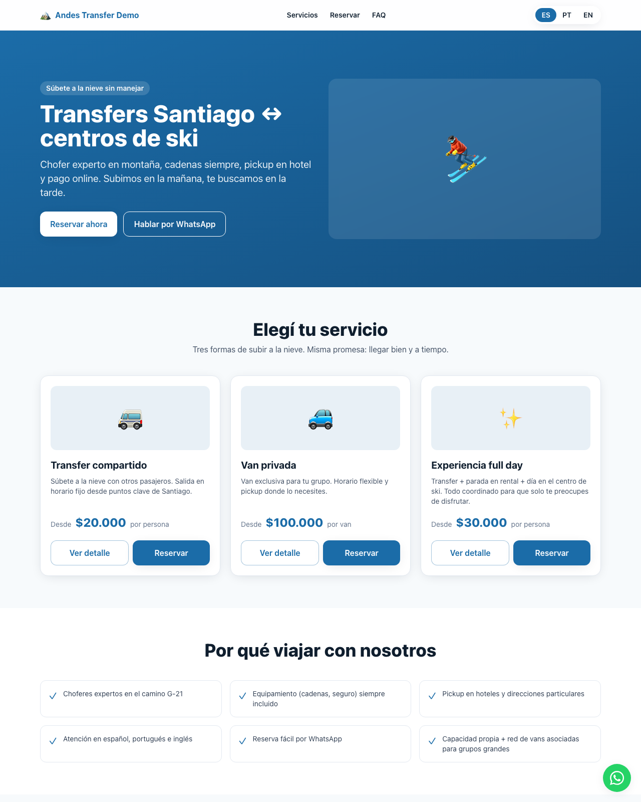
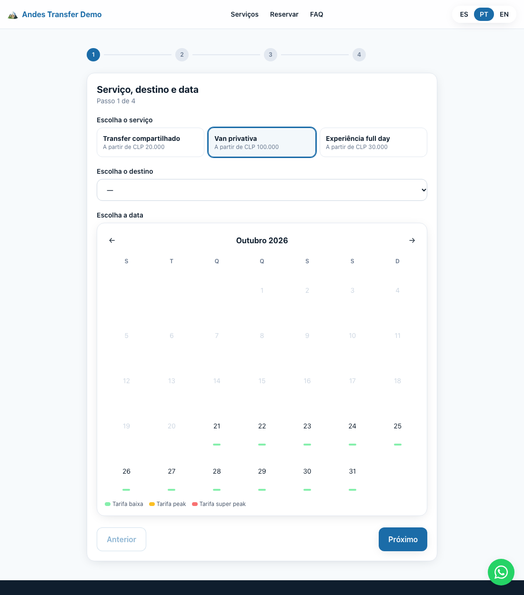

# ski-transfer-booking

Plataforma de **reservas online para transfers Santiago ↔ centros de ski** (El Colorado, Farellones,
La Parva y Valle Nevado): sitio público trilingüe (ES / PT-BR / EN), asistente de reserva mobile-first y
panel de administración. Todo el negocio (servicios, precios, temporadas, pickups, horarios, capacidad,
pagos y políticas) vive en **un solo archivo de configuración**. Es una versión generalizada de una
plataforma que diseñé y construí para un operador real de transfers.

> Este repositorio no contiene datos del cliente. La marca "Andes Transfer Demo", los contactos, los
> precios, las temporadas y los puntos de recogida son ficticios. Los centros de ski son destinos públicos.



## El problema

Un operador pequeño de transfers vende por WhatsApp y planillas. Cada reserva es una conversación larga
(servicio, fecha, pasajeros, punto de recogida, extras, precio según temporada) que se repite en tres
idiomas, porque también atiende a turistas de Brasil y de otros países. Los cupos se
cuentan a mano y nadie sabe con certeza cuántos asientos quedan para una salida. El operador necesita
**reservas online multilingües con un panel admin**, sin perder el canal que sus clientes ya usan:
WhatsApp.

## La solución

```text
                     config/business.ts  (fuente única del negocio)
                               │
        ┌──────────────────────┼─────────────────────────┐
        ▼                      ▼                         ▼
 sitio público           asistente de reserva        panel admin
 /es /pt /en             4 pasos, mobile-first       reservas · salidas · config
 (next-intl)             precio en vivo                    ▲
                               │ POST /api/reservas        │
                               ▼                           │
                  validación zod + reglas de negocio       │
                  precio recalculado en servidor           │
                               │                           │
                ┌──────────────┴──────────────┐            │
                ▼                             ▼            │
        Supabase (Postgres + RLS)      modo mock en memoria ┘
        trigger → cupos por salida     (sin backend)
                               │
                               ▼
          código AT-MMDD-XXX + mensaje prellenado a WhatsApp
          (o link de pago, si el pago online está activo)
```

- **Sitio público** (`app/[locale]/`): landing, fichas de servicio y FAQ en tres idiomas, con rutas
  `/es`, `/pt` y `/en`, metadata, sitemap y `robots` por idioma.
- **Asistente de reserva** (`components/reserva/Wizard.tsx`): servicio, destino y fecha en un calendario
  con colores por temporada; pasajeros y pickup; datos de contacto y extras; resumen. Cierra la reserva
  con un mensaje prellenado a WhatsApp o, si se activa, con un link de pago por el prepago.
- **API de reservas** (`app/api/reservas/route.ts`): valida con zod, comprueba que el destino, el pickup
  y los extras existan para ese servicio y **recalcula el precio en el servidor**. Genera un código corto
  y legible por teléfono (`AT-0728-A3F`, sin caracteres ambiguos).
- **Panel admin** (`app/[locale]/admin/`): tabla de reservas con filtros y cambio de estado, enlace a
  WhatsApp del pasajero con el resumen armado, ocupación por salida con semáforo y vista de la config.
- **Base de datos** (`supabase/migrations/`): tablas `reservas`, `salidas` y `config`; un trigger
  recalcula los asientos vendidos de cada salida y RLS deja crear reservas a anónimos y leerlas o
  editarlas solo a usuarios autenticados.
- **Pagos intercambiables** (`lib/pagos/`): link manual (operativo), y adaptadores de MercadoPago y Flow
  preparados como interfaz, sin integración en esta versión.



## Decisiones de diseño

- **Config-driven.** Un operador cambia precios, temporadas, pickups o textos editando
  `config/business.ts`, sin tocar componentes. La tabla `config` de Supabase es su espejo para editar sin
  redeploy. Dos banderas controlan el modelo comercial: `mostrarPrecios` (publicar precios o cotizar por
  WhatsApp) y `pagoOnlineHabilitado` (cobrar prepago o cerrar por WhatsApp).
- **i18n desde el primer día.** `next-intl` con prefijo de idioma en la URL y detección automática; los
  textos de la interfaz viven en `messages/{es,pt,en}.json` y los del negocio, como objetos `{ es, pt, en }`
  dentro de la config. El mensaje de WhatsApp sale en el idioma del pasajero.
- **WhatsApp como canal de cierre, no como competencia.** El sitio no obliga a pagar online: deja la
  reserva registrada con su código y abre WhatsApp con todos los datos. El operador conserva su forma de
  trabajar, pero ahora con un registro estructurado detrás.
- **Precio validado en el servidor.** El cliente muestra el precio en vivo, pero la API ignora los montos
  que recibe y los recalcula desde la config (tarifa por persona o por tramos de pasajeros, extras y
  multiplicador de temporada). Un usuario no puede reservar a $1 editando la petición.
- **Modo mock sin backend.** Si no hay credenciales de Supabase, las reservas se guardan en memoria del
  proceso y el admin acepta un login de demostración. Permite revisar el producto completo, hacer QA y
  mostrarlo sin crear cuentas ni bases de datos.
- **Restricción operativa en el modelo.** El camino a los centros de ski tiene horario de subida en la
  mañana y bajada en la tarde; los horarios por servicio y el cálculo de cupos por salida lo reflejan.

## Cómo correrlo

Requiere Node.js 18.17 o superior.

```bash
npm install
npm run dev            # http://localhost:3000/es  (modo mock: no necesita .env)

npm run typecheck      # TypeScript sin emitir
npm run lint           # ESLint (next/core-web-vitals)
npm run build          # build de producción
```

En modo mock, el admin está en `/es/admin` y acepta cualquier email y contraseña. Las reservas se pierden
al reiniciar el proceso.

Para usar Supabase: copia `.env.example` a `.env.local`, completa las variables, ejecuta en orden las
migraciones de `supabase/migrations/` (en el SQL Editor o con `psql`) y crea el usuario admin desde
Supabase Auth; el sitio no permite registrarse. La `SUPABASE_SERVICE_ROLE_KEY` solo se usa en el servidor.

Para adaptarlo a otro operador, edita `config/business.ts`: identidad, prefijo del código de reserva,
servicios, tramos de precio, temporadas, pickups, horarios, capacidad, pagos y política de cancelación.

## Hoja de ruta

- Integrar MercadoPago o Flow y su webhook firmado para confirmar reservas pagadas.
- Editar la configuración desde el panel admin, persistida en la tabla `config`.
- Cerrar fechas y ajustar la capacidad por salida desde el admin.
- Notificaciones por correo con el código de reserva.
- Pruebas automatizadas del cálculo de precios y de la API.

## Qué llevé a producción en el caso real

- El mismo sitio trilingüe, desplegado en Vercel con auto-deploy desde GitHub.
- Precios ocultos y cierre por WhatsApp (`mostrarPrecios` y `pagoOnlineHabilitado` en `false`) mientras el
  operador definía su tarifa y su medio de pago: las banderas permitieron salir a producción antes.
- Panel admin para ver reservas, cambiar estados y contactar pasajeros desde una sola pantalla.

## Stack

Next.js 14 (App Router) · TypeScript · Tailwind CSS · next-intl · Supabase (Postgres, Auth, RLS) · zod ·
Vercel

---

**Nicolás González Rojas** · Head of Data & BI · [LinkedIn](https://www.linkedin.com/in/nicolas-gonzalez-rojas)
